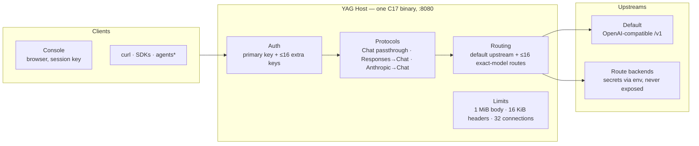

<div align="center">

```
██╗   ██╗ █████╗  ██████╗
╚██╗ ██╔╝██╔══██╗██╔════╝
 ╚████╔╝ ███████║██║  ███╗
  ╚██╔╝  ██╔══██║██║   ██║
   ██║   ██║  ██║╚██████╔╝
   ╚═╝   ╚═╝  ╚═╝ ╚═════╝
```

# Yet Another Gateway

**One host. Multiple models. Every interface.**

One native binary. One bearer key. A default upstream + up to 16 per-model routes.
Your upstream does the inference — YAG owns everything around it:
**auth, routing, protocol translation, limits.**

[](docs/architecture/STATUS.md)
[](#build)
[](#build)
[](#build)
[](console)
[](#configuration)
[](#security--threat-model)


```sh
export YAG_API_KEY="$(openssl rand -hex 32)"  # one key — that's the whole config
cmake -S . -B build && cmake --build build -j && ./build/yag
```

<!-- Screenshot slot — drop a PNG at docs/assets/console.png and uncomment:
<p>
  
</p>
-->

</div>

> [!WARNING]
> **This is a foundation, not a fortress.** The Responses adapter covers a documented
> subset — current Codex CLI requests do **not** work yet (a 0.167.0 probe against the
> mock upstream fails on an unsupported field). Anthropic support is non-streaming and
> limited. No TLS, no CORS, no audit log, no admin API. No real model, live provider or
> Claude Code has been tested. **Do not deploy this on an untrusted network.**
> Full scope: [architecture & status](docs/architecture/STATUS.md).

---

## The idea

You run OpenAI-compatible servers. Clients speak OpenAI, Responses, or Anthropic.
YAG sits in the middle and makes the two ends meet.

It never runs a model and never executes a tool — and never will.
That's not a limitation. That's the scope. YAG is a router, a translator
and a gatekeeper. Boring on purpose: C17, libcurl, pthreads, vendored yyjson.

- **One key in front of many backends** — a default upstream plus up to 16 exact-model routes, each with its own secret read from the environment.
- **Credentials never leave the host.** The browser sees your gateway key; the upstream key stays server-side. Always.

## Architecture



\* Codex CLI is a *future* client — not compatible yet. See the warning above.

## ✅ What works today

- **Host.** Localhost HTTP server, public `/health`, one primary bearer key plus up to 16 extra keys guarding `/v1/*` and `/api/*`.
- **Chat Completions.** `GET /v1/models` and `POST /v1/chat/completions`, including transparent upstream SSE streaming and tool-call structures. Bodies are passed through; upstream errors and status codes are forwarded verbatim. The upstream decides what it supports — YAG does not validate OpenAI semantics.
- **Responses subset (stateless).** Text, function calls and tool results, semantic SSE events, explicit rejection of unsupported features. Not yet Codex-compatible — see [Responses support](docs/architecture/STATUS.md).
- **Anthropic Messages (non-streaming).** `POST /v1/messages` for text and function tools: tool definitions, selection, `tool_use` and string `tool_result` replay. Accepts `Authorization: Bearer` or `x-api-key` with the YAG secret.
- **Console.** Served by the Host itself: session-only key entry, real status and model discovery, text chat with cancellation, copyable HTTP instructions. The playground doesn't do tools — API clients handle those themselves.
- **Hard limits, enforced.** Bounded request size, connection count, socket and upstream timeouts.
- **Tests.** Automated mock-upstream suite: auth, framing, discovery, tool data, streaming, errors, timeout, disconnection, concurrency.

## ❌ What doesn't

- Codex CLI compatibility — the 0.167.0 probe **failed** on an unsupported Responses field.
- Anthropic streaming, multimodal input, mixed text/tool-result blocks, token counting, Claude Code.
- Aggregate discovery across route backends. No failover once a matched backend fails — matched means **committed**.
- TLS, CORS configuration, audit logging, request history, admin API, per-key identity, revocation without restart, usage attribution, encrypted secret store, unauthenticated rate limiting.
- Model inference. Tool execution. Not YAG's job.

The model list is **not** a health or capability guarantee. Static route entries
don't guarantee their backends are reachable or support the requested operations.

## Endpoints

| Method | Path | Auth | What it does |
| --- | --- | --- | --- |
| `GET` | `/health` | — | Liveness probe. Public. |
| `GET` | `/api/status` | key | Host status. |
| `GET` | `/api/routes` | key | Configured model IDs. No URLs, no credentials. |
| `GET` | `/api/metrics` | key | In-memory counters by protocol. No prompts, no history. Resets on restart. |
| `POST` | `/api/provider/check` | key | `{}` for the default provider or `{"model":"<id>"}` → probes that route's `/models` with a 3 s timeout. Reachability only, never returns upstream details. |
| `GET` | `/v1/models` | key | Default upstream discovery + configured static route IDs. |
| `POST` | `/v1/chat/completions` | key | Passthrough, SSE included. |
| `POST` | `/v1/responses` | key | Responses subset, translated to Chat. |
| `POST` | `/v1/messages` | key | Anthropic Messages (non-streaming), translated to Chat. |

`/api/*` and `/v1/*` are rate-limited per key when `YAG_RATE_LIMIT_PER_MINUTE > 0` —
fixed 60-second windows, `429` on excess. Metrics count **request attempts**
(invalid ones included), not successful generations.

## Build

Linux. CMake 3.16+, a C17 compiler, libcurl dev headers, pthreads, Python 3 (tests),
Node 18+ and npm (Console only).

```sh
sudo apt install build-essential cmake libcurl4-openssl-dev python3 nodejs npm
cmake -S . -B build
cmake --build build -j
cd console && npm ci && npm run build && cd ..
ctest --test-dir build --output-on-failure
```

yyjson 0.12.0 is vendored under `third_party/yyjson` with its license.
The Console build is optional — API-only users can skip it. Generated assets are not
committed; `YAG_ASSETS` defaults to `console/dist` relative to the Host's working directory.

## Run

Start an OpenAI-compatible server first. Say it lives at `http://127.0.0.1:8000/v1`:

```sh
# Secrets go in your service manager / private environment — not in public files.
export YAG_API_KEY='REPLACE_WITH_A_LONG_RANDOM_SECRET'
export YAG_UPSTREAM_URL='http://127.0.0.1:8000/v1'
# Only if your upstream demands it:
# export YAG_UPSTREAM_KEY='YOUR_UPSTREAM_SECRET'

./build/yag
```

Open `http://127.0.0.1:8080`, pick **API key**, paste the YAG key. It lives in session
storage for the current tab — keep it private, clear it when done.
Or skip the browser entirely:

```sh
curl http://127.0.0.1:8080/health

curl http://127.0.0.1:8080/v1/models \
  -H "Authorization: Bearer $YAG_API_KEY"

curl http://127.0.0.1:8080/v1/chat/completions \
  -H "Authorization: Bearer $YAG_API_KEY" -H 'Content-Type: application/json' \
  -d '{"model":"YOUR_MODEL_ID","messages":[{"role":"user","content":"Hello"}],"stream":false}'
```

The Responses subset works without Codex too:

```sh
curl http://127.0.0.1:8080/v1/responses \
  -H "Authorization: Bearer $YAG_API_KEY" -H 'Content-Type: application/json' \
  -d '{"model":"YOUR_MODEL_ID","input":"Hello","store":false,"stream":false}'
```

Set `"stream":true` for SSE if the upstream supports it. Translation and validation
rules for Responses live in the [status doc](docs/architecture/STATUS.md).

> [!CAUTION]
> If a stream dies after the headers are sent, the connection just closes — the HTTP
> status cannot be changed retroactively. Clients must detect incomplete streams.

## Configuration

Read once at startup. Restart to apply.

| Variable | Default | Purpose |
| --- | --- | --- |
| `YAG_API_KEY` | *required* | Primary gateway bearer key, ≥16 chars. Generate something long and random. |
| `YAG_EXTRA_API_KEYS` | empty | Up to 16 extra keys, comma-separated, each ≥16 chars. No commas inside keys. |
| `YAG_RATE_LIMIT_PER_MINUTE` | `0` | Per-key limit on authenticated `/api/*` + `/v1/*`, fixed 60 s window. `0` = off, max `60000`. |
| `YAG_BIND` | `127.0.0.1` | Listen address. `0.0.0.0` only if you mean it. |
| `YAG_PORT` | `8080` | Listen port. |
| `YAG_UPSTREAM_URL` | `http://127.0.0.1:8000/v1` | HTTP(S) upstream API base. No trailing slash, query or fragment. |
| `YAG_UPSTREAM_KEY` | empty | Optional upstream bearer key. Never leaves the host. |
| `YAG_MODEL_ROUTES` | empty | JSON array of ≤16 `{model,url,key_env?}` routes, validated at startup. Matched models go there; everything else goes to the default. |
| `YAG_TIMEOUT` | `120` | Total upstream timeout, 1–3600 s. Connect timeout: 10 s. |
| `YAG_ASSETS` | `console/dist` | Path to the compiled Console assets. |

Multi-backend routing — secrets by reference, never inline:

```sh
export YAG_ROUTE_KEY='YOUR_SECOND_BACKEND_SECRET'
export YAG_MODEL_ROUTES='[{"model":"my-other-model","url":"http://127.0.0.1:9000/v1","key_env":"YAG_ROUTE_KEY"}]'
```

Routes are called by model ID. `GET /api/routes` lists them without leaking addresses
or secrets. `GET /v1/models` merges default-upstream discovery with the static route IDs.

## Security & threat model

Read this before exposing anything to a network you don't fully control.

- **Keys live in the environment.** Use your service manager's restricted secret
  provisioning and account permissions. Environment variables can be visible to
  privileged users or via process inspection. Rotating the primary key = restart.
- **Extra keys ≠ accounts.** They authenticate distinct clients, but there is no
  per-key identity, scope, usage attribution, or revocation without a restart.
- **What doesn't exist:** encrypted secret store, unauthenticated connection-level
  rate limiting, TLS server, CORS configuration, audit logging, request history,
  administrative API.
- **Public surface:** `/health` and Console assets only. Everything under `/v1/*`
  and `/api/*` requires the key.
- **Hard caps:** 1 MiB request bodies, 16 KiB headers, 32 concurrent connections,
  HTTP/1.x with connection close after each request, no chunked request bodies.
- **Networking:** localhost by default; LAN binding is explicit and emits a warning.
  Plain HTTP exposes your keys and your traffic. For anything remote: terminate TLS
  at a trusted reverse proxy, firewall the host, and independently assess this
  experimental server. **Wi-Fi membership is not authentication.** Native TLS and
  hardened network-facing operation are not implemented.

## Docs

- [Integration notes](docs/integrations/README.md)
- [Codex configuration & probe](docs/integrations/codex.md)
- [Architecture, scope & status](docs/architecture/STATUS.md)

---

<div align="center">

**YAG doesn't think. It decides who gets to ask.**

</div>
