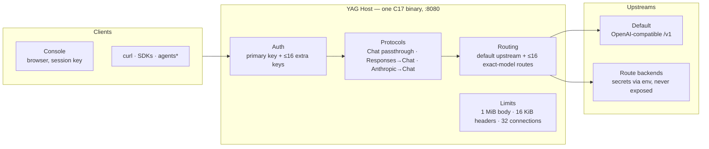

<div align="center">

```
██╗   ██╗ █████╗  ██████╗
╚██╗ ██╔╝██╔══██╗██╔════╝
 ╚████╔╝ ███████║██║  ███╗
  ╚██╔╝  ██╔══██║██║   ██║
   ██║   ██║  ██║╚██████╔╝
   ╚═╝   ╚═╝  ╚═╝ ╚═════╝
```

# Yet Another Gateway

**One host. Multiple models. Every interface.**

One native binary. One primary gateway key (plus optional additional keys). A default upstream + up to 16 per-model routes.
Your upstream does the inference — YAG owns everything around it:
**auth, routing, protocol translation, limits.**

[](docs/architecture/STATUS.md)
[](#build)
[](#build)
[](#build)
[](console)
[](#configuration)
[](#security--threat-model)


```sh
export YAG_API_KEY="$(openssl rand -hex 32)"  # one key — that's the whole config
cmake -S . -B build && cmake --build build -j && ./build/yag
```

<!-- Screenshot slot — drop a PNG at docs/assets/console.png and uncomment:
<p>
  
</p>
-->

</div>

> [!WARNING]
> **This is a foundation, not a fortress.** Codex CLI 0.167.0 completed a text exchange
> and a client-side shell-tool cycle against a deterministic mock backend; compatibility
> with real inference models remains unverified. The Anthropic adapter now handles
> streaming text and function tools. Claude Code CLI now completes streaming text
> and a local Read-tool cycle against a deterministic mock backend; real models
> remain **unverified**. No native TLS, CORS
> configuration, security audit log or network-exposed admin API. **Do not deploy this on an untrusted network.**
> Full scope: [architecture & status](docs/architecture/STATUS.md).

---

## The idea

You run OpenAI-compatible servers. Clients speak OpenAI, Responses, or Anthropic.
YAG sits in the middle and makes the two ends meet.

It never runs a model and never executes a tool — and never will.
That's not a limitation. That's the scope. YAG is a router, a translator
and a gatekeeper. Boring on purpose: C17, libcurl, pthreads, vendored yyjson.

- **One key in front of many backends** — a default upstream plus up to 16 exact-model routes, each with its own secret read from the environment. Pool replicas can optionally declare exact model allowlists.
- **Credentials never leave the host.** The browser sees your gateway key; the upstream key stays server-side. Always.

## Architecture



\* Codex has passed version-pinned mock qualification only; real model compatibility is unverified.

## ✅ What works today

- **Host.** Strict request-line spacing and control-byte checks; duplicate Host and competing auth headers are rejected. Localhost HTTP server, public `/health`, one primary bearer key plus up to 16 extra keys, with optional read-only/scoped access for extra keys. HTTP header/body deadlines and connection caps are enforced.
- **Chat Completions.** `GET /v1/models`, `GET /v1/models/{id}`, `POST /v1/chat/completions`, `POST /v1/completions` and `POST /v1/embeddings`, including transparent upstream SSE streaming for generation and tool-call structures for Chat. Bodies are passed through; upstream errors and status codes are forwarded verbatim. The upstream decides what it supports — YAG does not validate OpenAI semantics.
- **Responses subset (stateless).** Text, function calls and tool results (including namespaced function tools), semantic SSE events and explicitly rejected unsupported features. A pinned Codex CLI completed mock text and shell-tool cycles; see [Responses support](docs/architecture/STATUS.md).
- **Anthropic Messages.** `POST /v1/messages` translates text and function-tool exchanges in non-streaming and SSE modes. Tool definitions, selection, `tool_use`, mixed text/tool results, system text blocks and error-marked results are supported within a bounded subset. Accepts `Authorization: Bearer` or `x-api-key` with the YAG gateway secret.
- **Console.** Served by the Host itself: session-only key entry, real status and model discovery, text chat with cancellation, copyable HTTP instructions. The playground doesn't do tools — API clients handle those themselves.
- **Hard limits, enforced.** Bounded request size, connection count, socket and upstream timeouts.
- **Central AI Control Plane.** Local-only Console model downloads/deletion, persistent runtime LAN clients with immediate revocation, cgroup and optional Linux host-visible hardware metrics, FIFO inference scheduler and model-aware least-inflight replica pool with passive cooldowns. Operator CLI supports encrypted configuration backups and controlled updates. See [Control Plane operations](docs/operations/control-plane.md).
- **Additional multimodal passthrough.** OpenAI-compatible image generation and binary audio speech endpoints (backend support required, not implemented by Ollama automatically).
- **Tests.** Automated mock-upstream suite: auth, framing, discovery, tool data, streaming, errors, timeout, disconnection, concurrency and control-plane operations.

## ❌ What doesn't

- Complete Codex compatibility across real models and built-in server tools. The pinned mock-only Codex text and shell cycle passed; hosted `web_search` and other unsupported tool types are not provided by YAG.
- Full Claude Code compatibility with real models. A real Claude Code CLI now passes a text turn and local Read-tool cycle against a mock backend; multimodal inputs, native thinking, native token counting, prompt caching and server-side tools are still unsupported.
- Automatic capability verification and predictive provider routing. `/v1/models` combines the default upstream with static route IDs; an opt-in circuit breaker now suppresses calls to failing routed providers, and only definitively failed connection setup may be retried. Operator-declared capability hints and passive provider health counters are not live model verification.
- Native TLS, CORS configuration, audit logging, persistent request history, a security-audited identity system, encrypted-at-rest *live* credential store and unauthenticated connection-level abuse protection. The LAN profile uses a **separate** Caddy TLS proxy; runtime-managed clients can be revoked without restart, but static bootstrap credentials still live in the private environment file. No independent security audit has been completed.
- Complete cross-platform GPU telemetry and automatic cross-server capability matching. Linux DRM/sysfs can supply GPU utilization, VRAM and temperature when present, while NVIDIA-specific and other inaccessible sensors still need an exporter. Replica pools support explicit model allowlists, but YAG does not automatically verify model semantics.
- Model inference. Tool execution. Not YAG's job.

The model list is **not** a health or capability guarantee. Static route entries
don't guarantee their backends are reachable or support the requested operations.

## Endpoints

| Method | Path | Auth | What it does |
| --- | --- | --- | --- |
| `GET` | `/health` | — | Liveness probe. Public. |
| `GET` | `/api/status` | key | Host status. |
| `GET` | `/api/routes` | key | Configured model IDs. No URLs, no credentials. |
| `GET` | `/api/metrics` | key | In-memory counters by protocol. No prompts, no history. Resets on restart. |
| `GET` | `/api/clients` | monitor key | Per-key accepted/throttled request counts, positional labels and scopes. No secrets or prompts. |
| `GET` | `/api/scheduler` | monitor key | Active/waiting requests and inference concurrency settings. |
| `GET` | `/api/system/resources` | monitor key | cgroup RAM, Linux-visible CPU and RAM, optional DRM/sysfs GPU counters; sensor scope explicit. |
| `GET` | `/api/providers/pool` | monitor key | Default + replica load, passive health and request aggregates without URLs or secrets. |
| `GET/POST` | `/api/admin/clients*` | primary only (local) | List, issue, rename, enable/disable and revoke runtime client keys. |
| `GET/POST` | `/api/admin/ollama/*` | primary only (local) | Ollama installed/loaded models, background pull jobs and deletion. |
| `GET` | `/api/capabilities` | key | Explicit gateway protocol/limit support matrix (not model capability discovery). |
| `GET` | `/api/models/capabilities` | key | Operator-declared model capabilities (never marked verified). |
| `GET` | `/api/providers/status` | key | In-memory per-provider attempts, failures, circuit state, latency and reported tokens. |
| `POST` | `/api/provider/check` | key | `{}` for the default provider or `{"model":"<id>"}` → probes that route's `/models` with a 3 s timeout. Reachability only, never returns upstream details. |
| `GET` | `/v1/models` | key | Default upstream discovery + configured static route IDs. |
| `GET` | `/v1/models/{id}` | key | Fetch an exact model ID from the merged inventory; 404 if unknown. |
| `POST` | `/v1/chat/completions` | key | Passthrough, SSE included. |
| `POST` | `/v1/completions` | key | Legacy text completions passthrough, SSE if supported upstream. |
| `POST` | `/v1/embeddings` | key | Vector embeddings passthrough; requires upstream embedding model. |
| `POST` | `/v1/images/generations` | key | Image generation passthrough to a capable image backend. |
| `POST` | `/v1/audio/speech` | key | Speech synthesis passthrough; forwards binary audio response. |
| `POST` | `/v1/responses` | key | Responses subset, translated to Chat. |
| `POST` | `/v1/messages` | key | Anthropic text/function Messages, optional SSE streaming; translated to Chat. |

Monitoring endpoints require a key with the `monitor` permission (or `all`); active `POST /api/provider/check` requires the primary/all-scope key. Inference and model discovery can be separately restricted for additional keys.

`/api/*` and `/v1/*` are rate-limited per key when `YAG_RATE_LIMIT_PER_MINUTE > 0` —
fixed 60-second windows, `429` on excess with a `Retry-After` header indicating seconds remaining in the current window. Metrics count **request attempts**
(invalid ones included), not successful generations.

## Build

Linux. CMake 3.16+, a C17 compiler, libcurl dev headers, pthreads, Python 3 (tests),
Node 18+ and npm (Console only).

```sh
sudo apt install build-essential cmake libcurl4-openssl-dev python3 nodejs npm
cmake -S . -B build
cmake --build build -j
cd console && npm ci && npm run build && cd ..
ctest --test-dir build --output-on-failure
```

yyjson 0.12.0 is vendored under `third_party/yyjson` with its license.
The Console build is optional — API-only users can skip it. Generated assets are not
committed; `YAG_ASSETS` defaults to `console/dist` relative to the Host's working directory.

## Run

Start an OpenAI-compatible server first. Say it lives at `http://127.0.0.1:8000/v1`:

```sh
# Secrets go in your service manager / private environment — not in public files.
export YAG_API_KEY='REPLACE_WITH_A_LONG_RANDOM_SECRET'
export YAG_UPSTREAM_URL='http://127.0.0.1:8000/v1'
# Only if your upstream demands it:
# export YAG_UPSTREAM_KEY='YOUR_UPSTREAM_SECRET'

./build/yag
```

Open `http://127.0.0.1:8080`, pick **API key**, paste the YAG key. It lives in session
storage for the current tab — keep it private, clear it when done.
Or skip the browser entirely:

```sh
curl http://127.0.0.1:8080/health

curl http://127.0.0.1:8080/v1/models \
  -H "Authorization: Bearer $YAG_API_KEY"

curl http://127.0.0.1:8080/v1/chat/completions \
  -H "Authorization: Bearer $YAG_API_KEY" -H 'Content-Type: application/json' \
  -d '{"model":"YOUR_MODEL_ID","messages":[{"role":"user","content":"Hello"}],"stream":false}'
```

The Responses subset works without Codex too:

```sh
curl http://127.0.0.1:8080/v1/responses \
  -H "Authorization: Bearer $YAG_API_KEY" -H 'Content-Type: application/json' \
  -d '{"model":"YOUR_MODEL_ID","input":"Hello","store":false,"stream":false}'
```

Set `"stream":true` for SSE if the upstream supports it. Translation and validation
rules for Responses live in the [status doc](docs/architecture/STATUS.md).

> [!CAUTION]
> If a stream dies after the headers are sent, the connection just closes — the HTTP
> status cannot be changed retroactively. Clients must detect incomplete streams.

## Central LAN AI server (Colibri)

YAG can run on one central machine and serve multiple LAN PCs over
**HTTPS with a private CA**, separate scoped API keys and per-key rate
limits. The recommended Compose stack keeps Ollama's port private,
publishes only the TLS proxy on the server's selected LAN IP and keeps
the React Console local to the central machine.

```sh
python scripts/lan.py init --lan-ip 192.168.1.50 --clients 3 --managed-ollama
python scripts/lan.py doctor
python scripts/lan.py up
python scripts/lan.py model llama3.2
python scripts/lan.py ca
python scripts/lan.py check
```

The manager works on **Windows, Linux and macOS** with Python 3.9+ and
Docker Compose v2. On Windows use `py -3 scripts\\lan.py`; on Linux/macOS
use `python3 scripts/lan.py` if `python` is unavailable. Replace
`192.168.1.50` with your server's actual static LAN IP. Clients
connect to `https://192.168.1.50/v1` after installing the generated
private CA root. **Do not skip certificate verification or forward the
router's ports.** If Ollama already runs on the central host, use the
existing-host mode instead.

[Full LAN server deployment and client onboarding](docs/deployment/lan-hub.md).
[Control Plane APIs, resource limits, encrypted backups and replica management](docs/operations/control-plane.md).

## Ollama / Colibri quickstart

If Ollama is installed on the same machine as YAG, point the default upstream
at `http://127.0.0.1:11434/v1`. If it runs on Colibri on a **private LAN**,
use `http://colibri:11434/v1` only after securing Ollama's network access.

```sh
export YAG_API_KEY="$(openssl rand -hex 32)"
export YAG_UPSTREAM_URL="http://127.0.0.1:11434/v1"
./build/yag
```

Your applications connect to `http://127.0.0.1:8080/v1` with the YAG key
and select an installed model from `GET /v1/models`. Embedding clients use
`POST /v1/embeddings` with an embedding-capable model. The Ollama native
`/api` endpoints are not exposed.

**For another PC, IDE, automation or private-network device**, follow
[the Colibri / Ollama universal integration guide](docs/integrations/ollama-colibri.md).
Do not expose YAG or Ollama directly to the public internet.

## Configuration

Operator configuration is loaded at startup. Managed clients can be changed live; replica list changes still require a YAG redeployment.

| Variable | Default | Purpose |
| --- | --- | --- |
| `YAG_API_KEY` | *required* | Primary gateway bearer key, ≥16 chars. Generate something long and random. |
| `YAG_EXTRA_API_KEYS` | empty | Up to 16 extra keys, comma-separated, each ≥16 chars. No commas inside keys. |
| `YAG_EXTRA_KEY_SCOPES` | empty | Optional positional scopes for extra keys: `all`, `inference`, `models`, `monitor`, or `inference+models`. Primary key always has full access. |
| `YAG_RATE_LIMIT_PER_MINUTE` | `0` | Per-key limit on authenticated `/api/*` + `/v1/*`, fixed 60 s window. `0` = off, max `60000`. |
| `YAG_BIND` | `127.0.0.1` | Listen address. `0.0.0.0` only if you mean it. |
| `YAG_PORT` | `8080` | Listen port. |
| `YAG_UPSTREAM_URL` | `http://127.0.0.1:8000/v1` | HTTP(S) upstream API base. No trailing slash, query or fragment. |
| `YAG_UPSTREAM_KEY` | empty | Optional upstream bearer key. Never leaves the host. |
| `YAG_MODEL_ROUTES` | empty | JSON array of ≤16 `{model,url,key_env?}` routes, validated at startup. Matched models go there; everything else goes to the default. |
| `YAG_UPSTREAM_POOL` | empty | Up to 8 distinct replica backends for least-inflight scheduling. Replicas must serve identical model IDs. Keys via `key_env`. |
| `YAG_OLLAMA_ADMIN_URL` | empty | Explicit trusted Ollama native API origin for localhost-only admin model operations. |
| `YAG_CLIENT_STORE` | empty | Private owner-only JSON file enabling persistent runtime-issued client keys. |
| `YAG_MAX_INFERENCE` | `0` | Global in-flight inference limit (0 disabled; max 32). |
| `YAG_MAX_INFERENCE_PER_KEY` | `0` | Per-credential in-flight inference limit (0 disabled; max 32). |
| `YAG_INFERENCE_QUEUE_WAIT_MS` | `0` | FIFO queue timeout in ms (max 60000; max 24 waiting). |
| `YAG_MAX_BODY_BYTES` | `1048576` | Incoming request body limit (65536..8388608); LAN profile defaults to 4 MiB. |
| `YAG_MODEL_CAPABILITIES` | empty | JSON array (≤32) of `{model,features,context_window?}`. Features: streaming, function_tools, json_schema, reasoning, vision, audio. Operator assertions only, not probed. |
| `YAG_ENFORCE_MODEL_CAPABILITIES` | `0` | Opt-in (`1`) early HTTP 422 rejection if a declared model lacks requested tools, streaming, reasoning or JSON schema; unknown models are not presumed compatible. |
| `YAG_FALLBACK_TO_DEFAULT` | `0` | Opt-in (`1`) retry on DNS or connection errors only, before an upstream HTTP response; never on timeouts or HTTP errors. |
| `YAG_CIRCUIT_THRESHOLD` | `0` | 0 disables the circuit breaker; 1–20 upstream failures trip it for routed models. |
| `YAG_CIRCUIT_COOLDOWN_SECONDS` | `30` | Cooldown for a tripped route, 1–3600. One half-open request probes recovery. |
| `YAG_TRACE_ROUTES` | `0` | Opt-in (`1`) privacy-conscious route category diagnostics; does not log query values, prompts or credentials. |
| `YAG_TRACE_ANTHROPIC_SHAPE` | `0` | Opt-in (`1`) log allowlisted protocol fields and block categories on rejected Messages inputs, not prompt contents; use only for local diagnostics. |
| `YAG_TIMEOUT` | `120` | Total upstream timeout, 1–3600 s. Connect timeout: 10 s. |
| `YAG_HEADER_DEADLINE_SECONDS` | `10` | Monotonic deadline for incoming HTTP headers; 1–300. |
| `YAG_BODY_DEADLINE_SECONDS` | `30` | Monotonic deadline for HTTP request bodies; 1–3600. |
| `YAG_ASSETS` | `console/dist` | Path to the compiled Console assets. |

Multi-backend routing — secrets by reference, never inline:

```sh
export YAG_ROUTE_KEY='YOUR_SECOND_BACKEND_SECRET'
export YAG_MODEL_ROUTES='[{"model":"my-other-model","url":"http://127.0.0.1:9000/v1","key_env":"YAG_ROUTE_KEY"}]'
```

Routes are called by model ID. `GET /api/routes` lists them without leaking addresses
or secrets. `GET /v1/models` merges default-upstream discovery with static route IDs;
these entries do not guarantee backend capability. `YAG_FALLBACK_TO_DEFAULT=1` retries
only failed connection setup for mapped models; requests that received an HTTP response
or timed out are never transparently replayed.

SIGINT/SIGTERM drain in-flight workers before libcurl cleanup. The listener supports authenticated `Expect: 100-continue`, rejects invalid header names and serves Console assets without following symlinks. These hardening changes do **not** constitute a security audit.

Provider operations are visible through `/api/providers/status`. Token counters include **only usage actually reported by upstream Chat responses**, not estimates. Counters are in memory and reset at restart; a large stream may exceed the bounded usage observer and therefore not contribute tokens. Circuit breaker outcomes are passive: an HTTP `/models` probe or capability declaration does not certify tool calling or inference.

The default frontend exposes a model capability registry and per-provider operations summary. For production use, configure scopes, token rotation via your service manager, and a TLS reverse proxy. Static scopes cannot revoke live keys without restarting the gateway.

## Security & threat model

Read this before exposing anything to a network you don't fully control.

- **Keys live in the environment.** Use your service manager's restricted secret
  provisioning and account permissions. Environment variables can be visible to
  privileged users or via process inspection. Rotating the primary key = restart.
- **Extra keys ≠ accounts.** They authenticate distinct clients, but there is no
  per-key identity, scope, usage attribution, or revocation without a restart.
- **What doesn't exist:** encrypted secret store, unauthenticated connection-level
  rate limiting, TLS server, CORS configuration, audit logging, request history,
  administrative API.
- **Public surface:** `/health` and Console assets only. Everything under `/v1/*`
  and `/api/*` requires the key.
- **Hard caps:** 1 MiB request bodies, 16 KiB headers, 32 concurrent connections,
  HTTP/1.x with connection close after each request, no chunked request bodies.
- **Networking:** localhost by default; LAN binding is explicit and emits a warning.
  Plain HTTP exposes your keys and your traffic. For anything remote: terminate TLS
  at a trusted reverse proxy, firewall the host, and independently assess this
  experimental server. **Wi-Fi membership is not authentication.** Native TLS and
  hardened network-facing operation are not implemented.

## Protocol qualification

The native host, mock protocol tests and React console build pass. The pinned Codex
CLI mock test verifies one streamed text turn and a shell-tool round trip. Claude Code CLI also passes a streamed text turn and local Read-tool cycle on its
isolated mock. Both CLI qualification jobs remain informational; neither verifies
real-model compatibility or the full range of client tools.

## Docs

- [Real-model qualification](docs/integrations/live-model.md)
- [Isolated YAG real-backend probe](docs/integrations/real-model.md)
- [Docker / Compose deployment](docs/deployment/docker.md)
- [Linux release packaging](docs/deployment/releases.md)

- [Integration notes](docs/integrations/README.md)
- [Codex configuration & probe](docs/integrations/codex.md)
- [Claude Code setup & mock verification](docs/integrations/claude-code.md)
- [Architecture, scope & status](docs/architecture/STATUS.md)

---

<div align="center">

**YAG doesn't think. It decides who gets to ask.**

</div>
